<div align="center">



<br/>

[](https://shawonakando.dev/)
[](https://shawonakando.dev/resume/resume_shawon.pdf)
[](https://www.linkedin.com/in/shawon-akando/)
[](mailto:samshawon518@gmail.com)


[](https://github.com/samshawon10?tab=followers)




</div>



## ~/about

```text
$ whoami
shawon-akando

$ cat about.txt
Full-Stack Web Developer from Bangladesh who builds fast, SEO-friendly,
conversion-focused web products with React and Next.js.
Computer Science and Engineering student at United International University.
I like hard problems, clean architecture and shipping things people use.

$ cat focus.txt
-> performance-first React and Next.js interfaces
-> SEO-friendly sites that turn visitors into customers
-> clean, reusable component architecture
-> full-stack apps with Node.js, MongoDB and Firebase

$ cat status.txt
now building : CivicSync
studying     : CSE @ United International University
open to      : remote roles, freelance projects, open-source collaboration
```

<div align="center">

</div>


## ~/stack

<div align="center">

</div>

| area | tools |
|---|---|
| **languages** | `JavaScript` `TypeScript` `C` `C++` `Java` `Python` |
| **frontend** | `React` `Next.js` `Tailwind CSS` `daisyUI` `Ant Design` `Framer Motion` `Vite` `Chart.js` |
| **backend and data** | `Node.js` `Express` `MongoDB` `Firebase` `REST APIs` `Axios` |
| **tools and design** | `Git` `GitHub` `VS Code` `IntelliJ IDEA` `Figma` `Photoshop` `Illustrator` `Canva` `Notion` `Arduino` |
| **deploy** | `Vercel` `Netlify` `Firebase Hosting` |


## ~/projects

| project | what it does | stack |
|---|---|---|
| [**mess-mate-bd**](https://mess-mate-bd.vercel.app/) | Mess management platform for students and bachelors: room listings, bookings, facilities and a responsive mobile-friendly UI | `Next.js` `TypeScript` `Tailwind` `Firebase Auth` `Node.js` `MongoDB` |
| [**sbrn-fashion**](https://sbrn-fashion.vercel.app/) | Modern fashion e-commerce storefront with reusable components and smooth motion | `Next.js` `TypeScript` `Tailwind` `Framer Motion` `REST API` |
| [**swiftcart**](https://shswiftcart.netlify.app/) · [code](https://github.com/samshawon10/SwiftCart) | Full-stack e-commerce app with product browsing, auth, cart and secure checkout | `React` `Node.js` `Express` `MongoDB` `Firebase Auth` |
| [**raskillttc.com**](https://raskillttc.com/) | Client website for a training center, built around trust and clear admission paths | `Next.js` `React` `Tailwind` `SEO` |
| **CivicSync** | Currently in development | `React` `Next.js` `Tailwind` `Firebase` `Node.js` |

More work at [shawonakando.dev/projects](https://shawonakando.dev/projects)


## ~/activity

<div align="center">



<br/>


</div>


## ~/contact

```text
$ ./contact.sh --open
-> hiring for a frontend role?       email me or message on LinkedIn
-> need a fast, SEO-friendly site?   let's talk about your project
-> into open source?                 happy to collaborate
```

<div align="center">

[](https://shawonakando.dev/)
[](https://www.linkedin.com/in/shawon-akando/)
[](https://x.com/samshawon10)
[](https://fb.com/sam.shawon.akando)
[](https://instagram.com/samshawon10)
[](https://www.leetcode.com/shawonakando)
[](https://www.hackerrank.com/samshawon10)
[](https://coff.ee/samshawon10)


</div>
